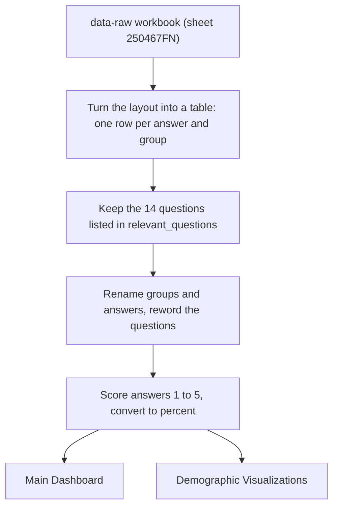

# Safer Supervision Polling Data Dashboard

An R Shiny dashboard that shows how voters answered a national poll on federal supervision reform and the Safer Supervision Act. The poll was conducted for REFORM Alliance by the polling firm Fabrizio Ward. The dashboard turns the firm's table workbook into one chart per question, for all respondents and for groups such as party, age and race.

**Live app:** not recorded in this repo yet. Add the address from the app's card in [Posit Connect Cloud](https://connect.posit.cloud) here.

## About the poll

| Detail | What the workbook says |
| --- | --- |
| Pollster | Fabrizio Ward, for REFORM Alliance |
| Sample | 1,000 voters, nationwide |
| Interview dates | Monday July 7 to Thursday July 10. The workbook gives no year; the weekdays match 2025. |
| Phone type | 25% landline, 35% cell and 40% text |
| Language | English or Spanish, at the respondent's choice |
| Split sample | Half the sample (506 people, Sample A) heard one wording of two of the statements and half (494, Sample B) heard the other |

The repo holds only the crosstab workbook, which reports percentages for each answer, overall and by group. It does not hold the questionnaire document, a margin of error, the weighting method or the individual responses. REFORM's public write-ups also describe a second, separate sample from competitive congressional districts; its results are not in this repo.

As a check on the data, the dashboard's first Safer Supervision Act question shows 37% strongly and 42% somewhat supporting, 79% in total. That matches the figure in REFORM's published summary of the poll.

## What the dashboard shows

The dashboard covers 14 of the poll's questions, in the four sections below.

| Section on the dashboard | Questions |
| --- | --- |
| Existing Voter Sentiment on Safer Supervision (4) | Support or oppose the Safer Supervision Act. More or less likely to vote for a member of Congress who voted for it. Support or oppose President Trump implementing some of the policies by executive order. Support or oppose the Act again, "having heard more". |
| Voter Sentiment on Criminal Justice Reforms (2) | Agree or disagree: reform must put public safety first. Agree or disagree: training people and getting them back to work helps communities, taxpayers and businesses. |
| Voter Sentiment on Supervision Reforms (4) | Support or oppose four reforms: ending one-size-fits-all supervision, incentives for an early end to supervision, more judicial discretion on technical violations, and ending supervision for low-risk people. |
| Gauging Further Voter Support for Safer Supervision (4) | Whether four arguments made by supporters of the Act are convincing or unconvincing. |

The "having heard more" question was asked after respondents had heard the supporters' arguments, so it measures opinion after hearing them. The first support question was asked before.

**Main Dashboard tab.** One stacked horizontal bar per question for all 1,000 respondents. The ❯ button at the left opens a Navigation drawer that jumps to a section or a question.

**Demographic Visualizations tab.** Choose a category (2024 Presidential Vote, Party Affiliation, Age, Gender, Systems-Impacted Status, Income, Race/Ethnicity or Type of Residential Area; Party Affiliation to start). Each question then shows a bar for Total and one bar for each group in the category.

**Reading a bar.** Colors run from red (strongly oppose, disagree, very unconvincing or much less likely) through orange, yellow (unsure, not sure or no impact) and light green to dark green (strongly support, agree, very convincing or much more likely). Gray is "Don't Know/Refused". Each bar is stretched to total 100%, because the workbook's whole-number percentages do not always add to exactly 100. Hovering shows the workbook's own percentage for that answer.

### Who answered

Group sizes matter when comparing groups.

| Group | Respondents |
| --- | --- |
| Whole sample | 1,000 |
| 2024 vote: Trump / Harris / Other | 420 / 405 / 175 |
| Party: Republican / Independent / Democrat | 358 / 299 / 344 |
| Age: 18-34 / 35-49 / 50-64 / 65 and over | 250 / 240 / 235 / 250 |
| Gender: Male / Female | 478 / 518 |
| Race or ethnicity: White / Black / Hispanic | 660 / 115 / 115 |
| Area: Urban / Suburban / Rural | 248 / 425 / 272 |
| Income: under $40k / $40-80k / $80-150k / $150k and over | 215 / 261 / 259 / 184 |
| Personally incarcerated / personally on probation or parole | 93 / 106 |
| Knows someone incarcerated / knows someone on probation or parole | 632 / 571 |

With groups this small, gaps of a few points between them can be chance, and the repo has no margin of error.

## Things to know before quoting the dashboard

- **The dashboard changes the survey wording.** To match REFORM's terms, `app.R` replaces "parole and probation", "parole" and similar phrases with "community supervision", and "Federal probation officers" with "Federal supervision officers". Respondents heard the original words. For example, the support question on the dashboard reads "reform the federal community supervision system"; respondents heard "reform the federal parole and probation system". The same replacement makes the heading above the supervision reforms read "reforms to the community supervision". For anything quoted as what voters were asked, use the workbook's wording.
- **Two statements were asked in two wordings.** For "public safety" and for the job-training statement, Sample A and Sample B heard slightly different words ("public safety" or "community safety"; "creates safer communities" or "helps taxpayers and local businesses"). The dashboard shows the combined results for all 1,000 people and prints the two wordings together, as the workbook does.
- **Most of the poll is not shown.** The workbook has about 60 tables. The dashboard leaves out, among others, the First Step Act questions, two of the six supervision reforms, four of the eight supporter arguments and some of the group breakdowns (education, vote history, region).
- **Summary rows are dropped.** The workbook's own summary lines (TOTAL SUPPORT, TOTAL OPPOSE, the net "D/S" lines and the MOV SUP and MOV OPP rows) are removed, so every bar is built from the individual answers. A "total support" number is the sum of the strongly and somewhat segments.
- **An answer's score is for ordering only.** The code gives each answer a 1 to 5 score (1 strongly negative, 3 unsure, 5 strongly positive) to sort and color the bars. Nothing averages the scores.

## How the data is prepared

`app.R` reads the workbook every time the app starts. The poll arrives as a spreadsheet laid out for reading, with a table title, the question text and a column of group totals, so roughly the first 250 lines of `app.R` reshape it into one tidy table.

1. The workbook's columns are the groups (Total, Trump voters, Harris voters and so on) and its rows are the answers. The code reads the group headings, then pairs each group with its column.
2. It finds each table by its "Table N" marker, reads the question text under it, and takes the "BASE=TOTAL SAMPLE" row as the group's respondent count.
3. It keeps only the questions in the `relevant_questions` list at the top of `app.R`. The match is on the exact text, so a question whose text differs by a character silently disappears.
4. It renames the group codes (for example `gop` becomes Republican), rewords the questions, converts 0.71 to 71, scores the answers and removes the summary rows.

The `question_id` in the saved data is a sort key the code creates. For all 14 questions it is one higher than the workbook's table number. For example, the first Safer Supervision Act question is Table 36 in the workbook and `question_id` 37.

## Repository layout

| File or folder | What it is |
| --- | --- |
| `app.R` | The whole dashboard: packages, workbook reshaping, page layout and server logic. |
| `data-raw/voter-poll-data-raw.xlsx` | The Fabrizio Ward crosstab workbook. This is the file the dashboard reads. |
| `data-raw/voter-poll-data-raw2.xlsx` | A second copy with the same values in every cell. Nothing reads it. |
| `data/poll_data_clean.csv` | A saved copy of the cleaned table (2,059 rows). The dashboard does not read it. See Known issues. |
| `renv.lock`, `renv/`, `.Rprofile` | Pinned package versions. `.Rprofile` switches renv on when the project opens. |
| `manifest.json` | The R version and package list that Posit Connect Cloud builds the app from. |
| `federal-voter-survey.Rproj` | The RStudio project file. The code finds `data-raw/` relative to it. |

The pinned version is R 4.5.0 with the packages in `renv.lock`. `app.R` loads database packages (`DBI`, `RPostgres`, `dbplyr`) but never connects to a database, so no credentials are needed.

## Use a new poll or add a question

1. Put the new workbook in `data-raw/` and change the file name in the `poll_data` step of `app.R`.
2. To add a question, copy its text from the workbook into `relevant_questions` exactly, including the sentence that introduces a group of statements. Then check the code that sets `response_type` and `question_type`, and the section labels, which decide where the question appears. The labels are written out in four places in the server code.
3. Check every answer wording in the new workbook against the scoring step. An answer with no score is drawn gray.
4. If the workbook adds a group, add a label for it in the renaming step. A new category also needs adding to the category list near the end of the cleaning code and to the dropdown on the Demographic tab.
5. Expect to adjust the reshaping steps if the new workbook's layout differs. The code relies on the "Table N" markers, the "BASE=TOTAL SAMPLE" row and the position of the group headings, and one table has a hard-coded fix.
6. Run the dashboard locally and check every chart against the workbook.

## Run it locally

1. Install R 4.5.0 and the RStudio desktop app.
2. Clone or download this repo and double-click `federal-voter-survey.Rproj`. RStudio opens the project and renv switches on by itself.
3. In the R console, run `renv::restore()` once. It installs the pinned package versions.
4. Open `app.R` and click **Run App**, or run `shiny::runApp()` in the console.

## Publish

REFORM hosts its Shiny dashboards on [Posit Connect Cloud](https://connect.posit.cloud), and this repo is set up for it (it has a `manifest.json`). Connect Cloud copies the code from GitHub and builds the app itself, so publishing an update means getting the change onto the GitHub branch it follows (normally `main`; **Settings > Source** in Connect Cloud shows which). Nothing is uploaded from your computer. Addresses have the form `https://<account>-<custom name>.share.connect.posit.cloud`, and REFORM's other dashboards use the account name `bfs6`.

### Publish an update

1. Make and test the change on your computer.
2. If you added or upgraded an R package, run `renv::snapshot()` and then `rsconnect::writeManifest()` in the R console, and commit both `renv.lock` and `manifest.json`. Connect Cloud reads `manifest.json` for the package list, so a stale one gives the live app the wrong packages or fails the build.
3. Commit and push to `main`, or merge a pull request into it. "Automatically publish on push" is on by default, so Connect Cloud rebuilds and redeploys the app at the same address.
4. Open the live address and check both tabs, including the navigation drawer.
5. If the live app did not change, sign in to Connect Cloud, open the app's card and look at the publish log for an error. **Republish** on the card redeploys from the latest code on GitHub.

### Publish for the first time, or re-create the app

1. Run `rsconnect::writeManifest()` in the R console. Commit and push `app.R`, `manifest.json` and `data-raw/voter-poll-data-raw.xlsx`.
2. Sign in to Connect Cloud with the account that owns REFORM's dashboards.
3. Click **Publish** at the top of your Home page. The first time, Connect Cloud asks you to install its GitHub App; give it access to this repository. A repo owned by the REFORM-Alliance organization may need an organization owner to approve the app.
4. Choose **Shiny**, then select this repository.
5. Confirm the **Branch** is `main` and the **Primary file** is `app.R`. Leave **Automatically publish on push** on.
6. Click **Publish** and watch the build log.
7. Open the app's **Settings > URL** and choose a custom name. The address becomes `https://<account>-<custom name>.share.connect.posit.cloud`. Write it at the top of this README.
8. Open the address in a private browser window to check that someone who is not signed in to Connect Cloud can use it.

### If something goes wrong

- **The repository is missing from the Publish list.** Connect Cloud's GitHub App does not have access to it. Give the app access in GitHub, then reload the list.
- **Free accounts can publish only public repositories.** If this repository is ever made private, the account needs a paid plan.
- **The build fails after a package change.** Run `rsconnect::writeManifest()` again, commit `manifest.json` and push.
- **A chart or question is missing.** Check the question's exact text against `relevant_questions` (see Use a new poll).
- **No secrets to set.** `app.R` reads no environment variables, so nothing is needed under Advanced settings.

## Known issues

Found by reading the code and checking the data files; the app was not run. Confirm each before changing anything.

- **"Age and Gender" does not appear.** The code's list of groups to keep includes "Age and Gender", and the workbook has the breakdown (men and women, 18-49 and 50 and over). The saved data has no such group. Reading the renaming steps in order suggests why: the rule that turns `age_gender` into "Age and Gender" comes after the rules for "age" and "gender", which have already changed the text so it no longer matches. Run the app to confirm.
- **`data/poll_data_clean.csv` is older than `app.R`.** It keeps the survey's original wording ("parole and probation") where `app.R` now writes "community supervision". Nothing in the repo writes or reads the file. Delete it, or regenerate it by saving the cleaned table from the app's `poll_data` step, so no one quotes old wording from it.
- **`manifest.json` is out of date.** Its recorded checksum for `app.R` no longer matches the file, so `app.R` has changed since the manifest was written. Run `rsconnect::writeManifest()` and commit the result before the next publish.
- **Unused files and packages.** `voter-poll-data-raw2.xlsx` is an unused duplicate. The app also loads several packages it never calls (database, map, spatial and date packages among them). They can be removed from the `library()` list.

## Sources

- [REFORM Alliance: Nearly 80% of Americans Demand Change](https://reformalliance.com/blog/safer_supervision_poll/), the published summary of this poll.
- [Florida Voice: Survey finds strong voter support for criminal justice reform, Safer Supervision Act](https://flvoicenews.com/survey-finds-strong-voter-support-for-criminal-justice-reform-safer-supervision-act/), which describes the national and competitive-district samples.